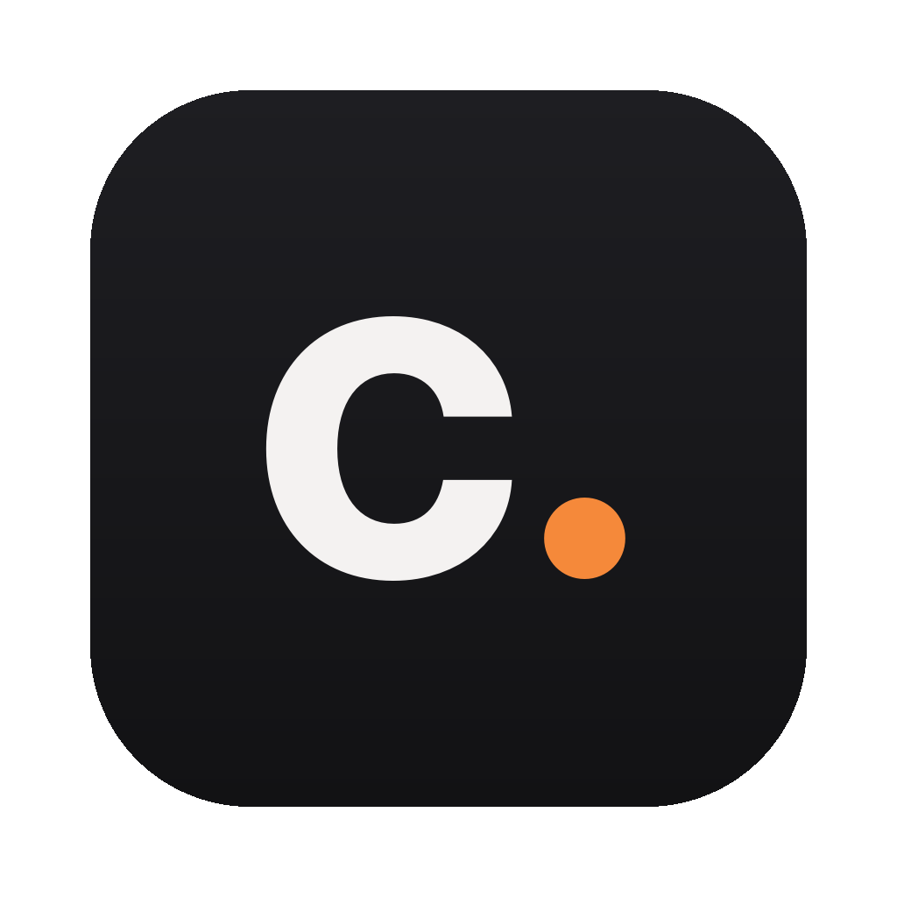
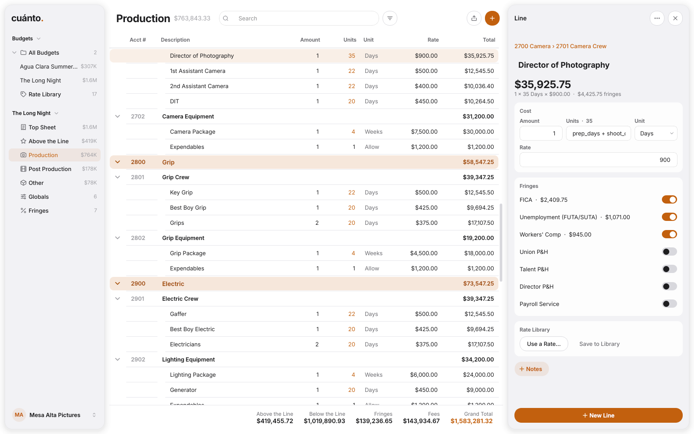

<p align="center"></p>

<h1 align="center">cuánto.</h1>
<p align="center"><b>Film and video budgets. Build them, see every number, track where the money goes.</b><br>
A top sheet, its accounts and every line, with globals, fringes and fees that keep themselves added up.
Runs on Mac, Windows and Linux.</p>

<p align="center"></p>

---

## Download

Click the one for your computer. These links always give you the newest version.

| Your computer | Download |
|---|---|
| Mac with Apple Silicon (M1 and newer) | **[Cuánto for Mac (Apple Silicon)](https://github.com/nickvenecia/cuanto/releases/latest/download/Cuanto-mac-apple-silicon.dmg)** |
| Intel Mac | **[Cuánto for Mac (Intel)](https://github.com/nickvenecia/cuanto/releases/latest/download/Cuanto-mac-intel.dmg)** |
| Windows | **[Cuánto for Windows (installer)](https://github.com/nickvenecia/cuanto/releases/latest/download/Cuanto-windows-setup.exe)** · [portable .zip](https://github.com/nickvenecia/cuanto/releases/latest/download/Cuanto-windows-portable.zip) |
| Linux | **[Cuánto for Linux (AppImage)](https://github.com/nickvenecia/cuanto/releases/latest/download/Cuanto-linux-x64.AppImage)** · [.tar.gz](https://github.com/nickvenecia/cuanto/releases/latest/download/Cuanto-linux-x64.tar.gz) |

Not sure which Mac you have? Apple menu → About This Mac: "Chip: Apple M…" means Apple Silicon. Every version is
on the **[Releases page](https://github.com/nickvenecia/cuanto/releases)**.

**Installing:**
- **Mac:** open the .dmg and drag Cuánto into Applications. The first time, if macOS says it can't check the app:
  open **System Settings → Privacy & Security**, scroll down and click **Open Anyway**. Only once.
- **Windows:** run the installer (no admin needed). If SmartScreen pops up, click **More info → Run anyway**.
- **Linux:** make the AppImage runnable (right-click → Properties → Allow executing, or `chmod +x`) and double-click it.

Everything comes bundled, fonts included. Each time Cuánto opens it checks for a new version and, if there is one,
shows what's new right away (**Later** closes it; **Update to …** stays at the bottom of the sidebar).

## What it does

**The way budgets are read.** A top sheet of categories in four sections (Above the Line, Production, Post
Production, Other), the accounts under each category, and the lines in each account. Every subtotal, section,
fringe and fee adds itself up, all the way to the grand total, while you type.

**A line is so many, for so long, at a rate.** Two grips, for 20 days, at $375 a day. Units are days, weeks,
hours, months, flat, an allowance, each or units. Type in the line's panel on the right, or right over the line
in the table.

**Globals.** Name a number once (`shoot_days = 20`, `prep_days`, `crew_size`) and use it in any line:
`shoot_days + 2`, `crew_size × 1.1`. Change it and every line that uses it follows; rename it and every formula
follows too. A number that comes from a global shows in the accent, so you can tell.

**Fringes.** Payroll taxes, union pension & health, workers' comp: a percent of each line (counting no more than
a wage cap, when there is one) or a flat amount per unit. Switch them on line by line, or on every line of an
account at once.

**Fees on the top sheet.** Contingency, a production fee, a markup: each a percent of above and below the line,
below the line, production only, or everything above it, or a flat amount.

**Templates.** Start from an indie feature, a short film, a commercial laid out like the AICP bid form, a music
video, or blank. Each comes with the usual categories, accounts and lines, already tied to its schedule's globals
and fringes. Rates start empty: they're yours. Or make your own: **Save as Template…** keeps any budget's
categories, accounts, lines, globals, fringes and fees (its rates too, if you like), without its client, dates or
spending, and it's there under **New Budget** from then on. Rename or delete yours in Settings › Templates.

**A rate library.** Keep crew rates (union and non-union, with their local) and vendor prices once and use them
in any budget. **Use a Rate…** puts one on a line, with its fringes; **Save to Library** keeps a line's rate.

**Paper and spreadsheets.** The top sheet and the detail open in their own window, exactly as they print: **Save
PDF…**, **Print…**, or a picture. They carry your production company's name, logo and contact (Settings ›
Profiles). **Export Excel…** writes the top sheet, the detail, the globals and the fringes.

**Bring things in, send them out.** **Import CSV…** reads budget lines from a sheet laid out by hand (it finds the
Description, Amount, Units, Rate, Total… columns by their titles). JSON goes both ways: other tools can send in
rates, a schedule and crew, or take a budget out (a locked one, for invoicing). The format is in
**[docs/exchange.md](docs/exchange.md)**.

**Yours, on your computer.** Budgets save themselves as you work, every change can be undone (⌘Z), and nothing
leaves your computer. Light or dark follows your computer (View → Appearance), and you can pick the accent color in
Settings › General.

## Coming next

Versions of a budget (bid, locked, actuals) with a cost report of what's over and under; more than one currency
on a budget (USD and MXN) with live exchange rates; and optional AI help with your own key, from any provider.

## Running it from the code

```bash
python3 -m venv .venv && source .venv/bin/activate
pip install -r requirements.txt        # (requirements-dev.txt for ruff, pytest, pyinstaller)
python -m cuanto
```

The same pages and numbers without a window: `python -m cuanto cli --help`.

Your budgets live in `~/Library/Application Support/Cuanto` (Mac), `%LOCALAPPDATA%\Cuanto` (Windows) or
`~/.local/share/cuanto` (Linux). Settings › Your Data shows the folder and makes a backup.

## License

GPL-3.0. The fonts are under the SIL Open Font License (see [THIRD_PARTY_NOTICES.md](THIRD_PARTY_NOTICES.md)).
